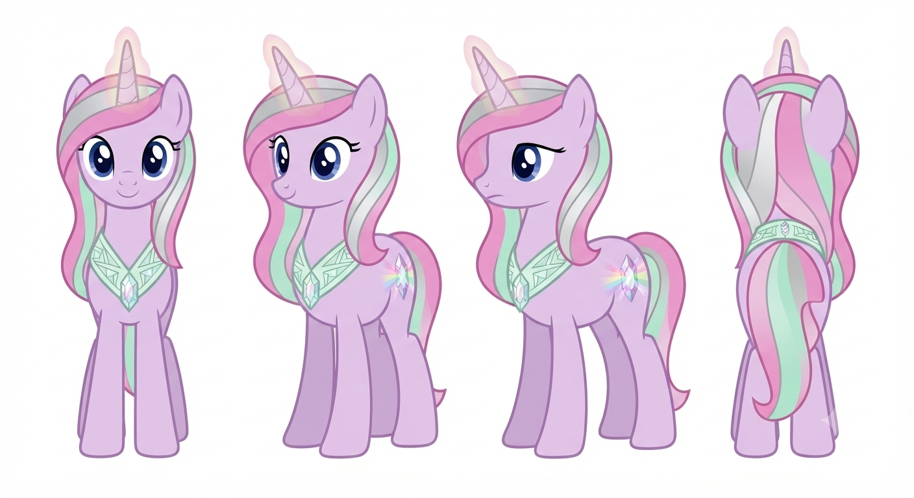
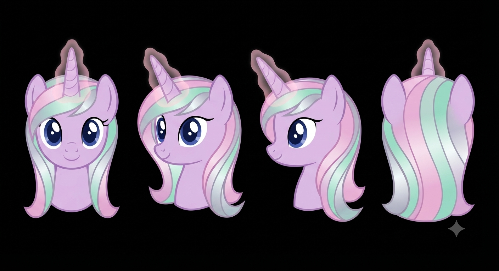
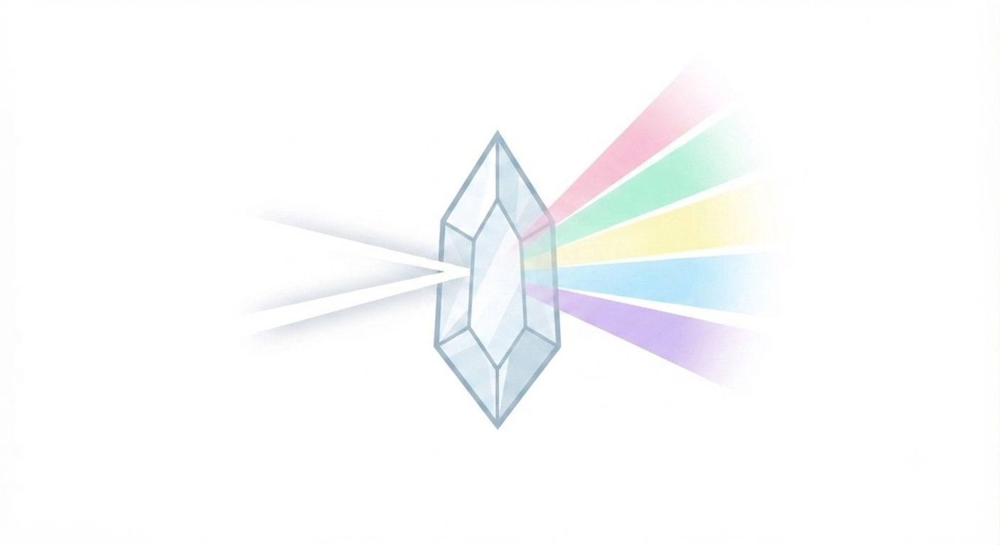

# Character Profile: Polaris Prism
*(The Delegate of the Crystal Empire)*

**Role:** Chief Diplomatic Envoy & Luminary Liaison
**Race/Sex:** Unicorn | Female

---

## ✦ Main Style & Persona

*   **Appearance:** A pristine, soft lavender-coated Unicorn with an iridescent, multi-toned pastel mane that shifts softly like polarized light (pale crystal pink, mint, and silver). She has deep, expressive sapphire-blue eyes, polished silver-grey hooves, and an aura of calm, radiant grace.
*   **Cutie Mark:** A faceted crystal prism refracting a beam of white light into a synchronized spectrum of harmonious pastel rays—representing emotional clarity, moral cohesion, and the channeling of collective positive energy.
*   **Personality:** Deeply empathetic, steadfast, articulate, and fiercely devoted to community welfare. She approaches political disagreements not as tactical combat, but as a disharmony to be patiently resolved through shared morale and open-hearted dialogue.
*   **Quirks:** Unconsciously spins a small, perfectly cut prism pendant around her magic aura when listening intently; regularly pauses to take a deep, centering breath before responding to hostile rhetoric.
*   **Notable Flaw:** *Emotional Vulnerability & Dogmatic Optimism.* She assumes that sheer goodwill, emotional resilience, and traditional pageantry can heal any structural or economic crisis, leaving her dangerously slow to adapt when facing cynical, hard-edged pragmatists or bad-faith actors.
*   **Favorite Quote:** *“A true shield is built not from iron walls, but from the unyielding warmth of a united community.”
*   **Hobbies:** Crystal-facet carving, organizing seasonal light festivals, historical choir arrangement, and stargazing from high spire observatories.

---

## ✦ Professional Attributes & Ideology

*   **Occupation/Title:** Head Delegate of the Crystal Empire's Foreign Ministry & Cultural Preservation Envoy.
*   **Backstory & Rise to Power:** Hailing from a lineage of master crystal-smiths and civic historians, Polaris rose through the ranks of the Crystal Heart Academy. She distinguished herself by successfully mediating generational cultural friction during the Empire's post-restoration era, using public community-building initiatives to bridge ideological divides.
*   **Pros and Cons Based on City Ideology:**
    *   **Pros:** Exceptional capability to de-escalate tension, inspire deep trust, and rally populations under a unified, morale-driven protective consensus.
    *   **Cons:** Struggles severely in high-stakes, transactional environments where emotional appeal holds no weight and opponents demand cold, cynical compromise.
*   **Language Style & Rhetoric:** 
    *   *Tone & Cadence:* Melodic, measured, soothing, and unfailingly polite—imbued with the serene confidence of a spiritual anchor.
    *   *Vocabulary/Jargon:* "Resonance," "Harmonic Unity," "Collective Morale," "Luminescent Core," "Shared Radiance."
    *   *Forms of Address:* Addresses peers as "Honored Friend," "Fellow Citizen," or "Esteemed Colleague," fostering an immediate atmosphere of mutual respect.
    *   *Metaphor Domain:* Crystal optics, thermal radiation, musical harmony, and architectural pillar integrity.
*   **Professionalism:** Maintains absolute, radiant composure under pressure. When confronted with hostility, she responds with disarming grace, seeking to outlast aggression through sheer unwavering hospitality.
*   **Social Value:** Champions the Crystal Empire as the emotional heart of Equestria—proving that a society anchored in mutual empathy and shared joy is far more enduring than one built on cold utility or isolated wealth.

---

## ✦ Civic Policy & Statecraft (Simulator Mechanics)

*   **Political Faction Name:** The Crystal Vanguard & Radiant Concord
*   **Infrastructure & Development:** Harmonious, crystal-spire architecture emphasizing open public plazas, shimmering prismatic glass-domed halls, and communal warmth loops that distribute light and energy evenly across all districts.
*   **Economic & Resource Policy:** Managed artisan economy backed by a communal resource pool. Focuses on the refinement of luminescent materials and reciprocal cultural exchange rather than aggressive market capitalism.
*   **Civic Duty & Participation:** Active participation in communal morale-building, traditional festivals, and mutual aid networks to maintain the protective energy grid.

---

## ✦ Visual Reference Guide

**1. Physical Build & Stance**
*   **Stature:** Graceful, balanced Unicorn build with standard athletic proportions and a serene posture.
*   **Posture:** Upright, open, and inviting; stands with an even weight distribution, projecting welcoming leadership.
*   **Horn/Wings:** Slender, elegant horn emitting a soft, warm pastel-pink and silver magical aura.

**2. The Mane & Tail (The Focal Point)**
*   **Style/Cut:** Neatly brushed, flowing waves that cascade over one shoulder, catching ambient light like a prism.
*   **Texture/Color:** Silky texture with shifting tones of pale crystal pink, soft mint, and shimmering silver highlights.

**3. The Cutie Mark**
*   **Placement:** Left flank.
*   **Visuals:** A faceted crystal prism splitting a single beam into harmonious, glowing pastel rays.
*   **Reference:** `PolarisCutiemark.png`

**4. Signature Accessories**
*   `[Crystal Prism Pendant]`: A clear, perfectly cut quartz pendant worn on a silver chain that catches ambient light and focuses her magical concentration.
*   `[Embroidered Civic Sash]`: A pale mint-green silk sash stitched with subtle geometric crystal patterns, signifying her official diplomatic status.
*   **Reference:** `database/delegates/crystal_polaris/PolarisAccessories.png`

**5. Movement & Mannerisms**
*   **Sound:** Soft, rhythmic hooffalls accompanied by the faint, crystalline chime of her pendant brushing against her collar.
*   **Expression:** A gentle, welcoming smile with bright, attentive eyes that convey genuine interest and deep calm.
*   **Personal Space:** Maintains a warm, comfortable social distance, favoring an open posture that encourages approachability.

---
### Character Portraits

